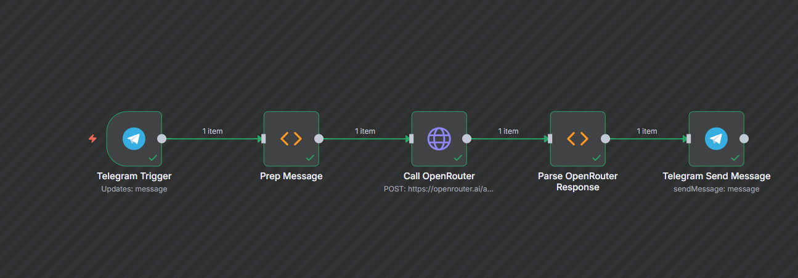

# AIBot n8n Workflow

A Telegram AI Chatbot built with n8n workflow automation that integrates with OpenRouter's Polaris Alpha model to provide intelligent responses.

## 🚀 Features

- **Smart Message Processing**: Handles various message types and commands
- **AI-Powered Responses**: Uses OpenRouter's Polaris Alpha model
- **Code Formatting**: Properly formats code blocks for Telegram
- **Error Handling**: Graceful fallbacks for API failures
- **Rich Text Support**: MarkdownV2 formatting with proper escaping
- **Elegant UI**: Branded responses with clear structure

## 📋 Prerequisites

Before setting up this workflow, you'll need:

1. **n8n Instance** - Self-hosted or cloud
2. **Telegram Bot Token** - Create via [@BotFather](https://t.me/botfather)
3. **OpenRouter API Key** - Get from [OpenRouter](https://openrouter.ai/)

## 🛠️ Installation

### 1. Import Workflow
1. Copy the contents of `src/AIBot_Workflow.json`
2. In n8n, go to **Workflows** → **Import from File/URL**
3. Paste the JSON content and import

### 2. Configure Credentials

#### Telegram API
1. Go to **Credentials** → **Add Credential**
2. Select **Telegram API**
3. Enter your bot token from BotFather

#### OpenRouter API
1. Go to **Credentials** → **Add Credential**
2. Select **HTTP Header Auth**
3. Set header name: `Authorization`
4. Set header value: `Bearer YOUR_OPENROUTER_API_KEY`

### 3. Update Configuration
- Update the HTTP-Referer header in the "Call OpenRouter" node to match your n8n instance URL
- Activate the workflow

## 🔧 Configuration

### Bot Personality
The AI assistant is configured as "Polaris Alpha" with:
- Quick and reliable responses
- Polite and professional tone
- Clear and concise communication
- Temperature: 0.6 (balanced creativity)
- Max tokens: 512 (concise responses)

### Customization
You can modify the system prompt in the "Call OpenRouter" node to change the bot's personality and behavior.

## 📊 Workflow Structure

The workflow consists of 5 main nodes:

1. **Telegram Trigger** - Listens for incoming messages
2. **Prep Message** - Processes and formats input
3. **Call OpenRouter** - Makes API calls to AI service
4. **Parse OpenRouter Response** - Formats AI responses
5. **Telegram Send Message** - Sends formatted replies

## 🤖 Usage

### Try the Live Bot
🔗 **[Try AIBot on Telegram](https://t.me/GeminiOrbitBot)** *(Replace with your actual bot username)*

### How to Use
1. Start a conversation with your bot on Telegram
2. Send `/start` to get a welcome message
3. Ask any question or request assistance
4. The bot will respond with AI-generated answers

### Example Commands
- `/start` - Get welcome message and bot introduction
- `What is Python?` - Ask any technical question
- `Write a simple function` - Request code examples
- `Explain machine learning` - Get detailed explanations

## 📝 License

This project is licensed under the MIT License - see the [LICENSE](LICENSE) file for details.

## ✅ Verification Status

Verified in this audit:

| Check | Result |
| --- | --- |
| Workflow JSON (`src/AIBot_Workflow.json`) | PASS — valid JSON (utf-8-sig), 7,250 chars |
| Node structure vs. README | PASS — exactly 5 nodes: Telegram Trigger, Prep Message, Call OpenRouter, Parse OpenRouter Response, Telegram Send Message |
| Node connections | PASS — wired Trigger → Prep → OpenRouter → Parse → Send |
| Hardcoded credentials scan | PASS — no OpenRouter keys, Telegram tokens, JWTs, or key=value secrets found |

Notes:
- No test suite or CI workflow exists in the repository; verification above is structural (JSON parse + node graph), not runtime (requires a running n8n instance).
- Credentials (Telegram bot token, OpenRouter API key) must be configured in the n8n credentials UI — they are deliberately absent from the workflow file.

## 👨‍💻 Author

**TAKSH ASHISH GANDHI** - 2025

## 🤝 Contributing

Contributions are welcome! Please feel free to submit a Pull Request.

## 🔗 Links

- 🤖 **[Live Bot Demo](https://t.me/GeminiOrbitBot)** - Try the bot yourself
- 📚 **[Setup Guide](./docs/setup-guide.md)** - Detailed installation instructions
- 🔧 **[API Reference](./docs/api-reference.md)** - Technical documentation
- 🤝 **[Contributing](./CONTRIBUTING.md)** - How to contribute

## 📞 Support

If you encounter any issues or have questions, please open an issue in this repository.
